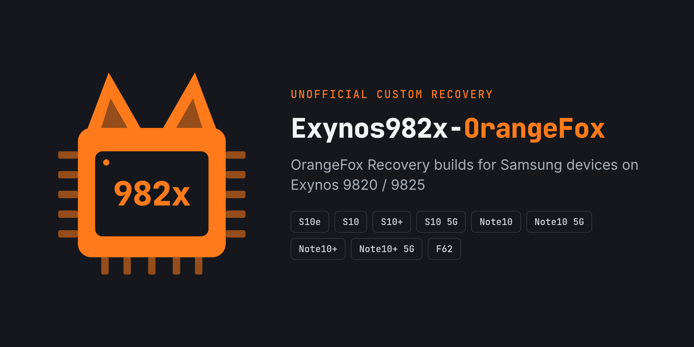

  

  
  
  
  

Unofficial [OrangeFox Recovery](https://orangefox.tech) for the Samsung Galaxy S10, Note10 and F62
series, built from open device trees, with **/data decryption** using the TEE of your installed
ROM — no proprietary files shipped, nothing to update when your ROM gets a new security patch.

### 📥 Get it

Builds, installation guide, requirements and known issues are all in
**[OrangeFox_Exynos982x](https://github.com/Exynos982x-OrangeFox/OrangeFox_Exynos982x)**.
Read the requirements first: these builds target ROMs built on the LineageOS device trees, not One UI.

### 📱 Devices

| Device | Codename | Device tree | Status |
| :-- | :-- | :-- | :-- |
| Galaxy S10e | `beyond0lte` | [android_device_samsung_beyond0lte](https://github.com/Exynos982x-OrangeFox/android_device_samsung_beyond0lte) | 🧪 Needs testing |
| Galaxy S10 | `beyond1lte` | [android_device_samsung_beyond1lte](https://github.com/Exynos982x-OrangeFox/android_device_samsung_beyond1lte) | 🧪 Needs testing |
| Galaxy S10+ | `beyond2lte` | [android_device_samsung_beyond2lte](https://github.com/Exynos982x-OrangeFox/android_device_samsung_beyond2lte) | ✅ Tested |
| Galaxy S10 5G | `beyondx` | [android_device_samsung_beyondx](https://github.com/Exynos982x-OrangeFox/android_device_samsung_beyondx) | 🧪 Needs testing |
| Galaxy Note10 | `d1` | [android_device_samsung_d1](https://github.com/Exynos982x-OrangeFox/android_device_samsung_d1) | 🧪 Needs testing |
| Galaxy Note10 5G | `d1x` | [android_device_samsung_d1x](https://github.com/Exynos982x-OrangeFox/android_device_samsung_d1x) | 🧪 Needs testing |
| Galaxy Note10+ | `d2s` | [android_device_samsung_d2s](https://github.com/Exynos982x-OrangeFox/android_device_samsung_d2s) | 🧪 Needs testing |
| Galaxy Note10+ 5G | `d2x` | [android_device_samsung_d2x](https://github.com/Exynos982x-OrangeFox/android_device_samsung_d2x) | 🧪 Needs testing |
| Galaxy F62 | `f62` | [android_device_samsung_f62](https://github.com/Exynos982x-OrangeFox/android_device_samsung_f62) | 🧪 Needs testing |

All devices share the [common tree](https://github.com/Exynos982x-OrangeFox/android_device_samsung_exynos9820-common).
Each device tree's README explains how to build it.

### 🧪 Help us test

Own one of these devices? Flash the latest build and file a
[test report](https://github.com/Exynos982x-OrangeFox/OrangeFox_Exynos982x/issues/new?template=test_report.yml) —
even if everything works. Found a bug? Open a
[bug report](https://github.com/Exynos982x-OrangeFox/OrangeFox_Exynos982x/issues/new?template=bug_report.yml)
with your logs.

### 🙏 Credits

[OrangeFox Recovery](https://orangefox.tech) · [TeamWin](https://twrp.me) ·
[LineageOS](https://github.com/LineageOS) · [ExtremeXT](https://github.com/ExtremeXT/android_device_samsung_exynos9820)

Not affiliated with Samsung or the OrangeFox Recovery team.
